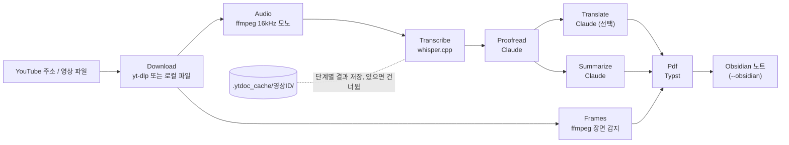

# youtube-summary

YouTube 영상 주소나 내 컴퓨터의 영상 파일을 넣으면 요약 문서를 PDF로 만들어 주는 Rust 프로그램 `ytdoc`입니다. 받아쓰기, 장면 뽑기, PDF 조판은 내 컴퓨터에서 하고, 받아쓰기 다듬기, 번역, 요약에만 Claude를 씁니다. 브라우저 화면(`ytdoc serve`)과 명령줄 두 가지로 쓸 수 있습니다.

- 포트폴리오 상세: https://ji-geunyeong.kro.kr/projects/youtube-summary
- 예시 PDF: [`examples/JdgjWfve1DY.ko.pdf`](examples/JdgjWfve1DY.ko.pdf) (생활코딩 「HTML - caniuse」, CC BY, 만든 방법은 [`examples/README.md`](examples/README.md))

PDF에 들어가는 내용은 다음과 같습니다.

- 표지: 제목, 채널, 영상 길이, 주소, 한 줄 요약
- 전체 요약, 핵심 포인트, 목차, 비교표(영상이 무언가를 비교할 때만), 용어 정리
- 챕터별 페이지: 시간 구간(YouTube 영상이면 누를 때 해당 시점으로 이동), 핵심 장면 이미지, 요약, 핵심 포인트
- 부록: 시간이 표시된 전체 받아쓰기 (번역을 켜면 번역문만 들어갑니다)

## 문제 해결 사례

### 1. 멈춰도 이어서 — 단계별 캐시

- **문제**: 받아쓰기만 해도 오래 걸립니다(Apple M1, 6분 10초 한국어 영상, `large-v3-turbo`에서 87~124초. 아래 [시간이 얼마나 걸리나요](#시간이-얼마나-걸리나요)의 이전 버전 측정값). 중간에 멈출 때마다 처음부터 다시 하면 낭비가 큽니다.
- **해결**: 단계 결과를 `.ytdoc_cache/<영상ID>/`에 JSON으로 저장합니다. 임시 파일에 쓴 뒤 이름을 바꿔 저장하므로, 파일이 있으면 그 단계는 끝난 것이고 깨진 파일은 다시 계산합니다. 받아쓰기, 번역, 요약 파일 이름에는 모델과 언어를 넣어, 설정을 바꾸면 따로 저장합니다. ([`src/cache.rs`](src/cache.rs), [`src/pipeline.rs`](src/pipeline.rs))
- **결과**: 같은 영상을 다시 실행하면 끝난 단계는 건너뛰고 남은 단계만 합니다. 한 번만 계산하는지, 실패한 단계가 표식 파일을 남기지 않는지, 깨진 파일을 다시 만드는지는 `src/cache.rs`의 테스트로 확인합니다.

### 2. 받아쓰기 오류가 요약으로 번지지 않게

- **문제**: 받아쓰기가 용어를 잘못 들으면(예: "대역폭"을 "대역복"으로) 번역, 요약, PDF에 그대로 들어갑니다.
- **해결**: Claude에게 받아쓰기를 나누어 보내 확실히 잘못 들린 줄만 줄 번호와 고친 글로 받습니다. 그 줄의 글만 바꾸고 시간은 그대로 두며, 바뀐 줄만 `transcript-fixes` 파일에 저장합니다. 범위를 벗어난 번호와 빈 글은 무시합니다. ([`src/proofread.rs`](src/proofread.rs))
- **결과**: 번역, 요약, PDF가 고친 받아쓰기를 읽습니다. 이 단계를 추가해도 받아쓰기, 장면 뽑기 같은 다른 단계의 캐시는 그대로 씁니다.

### 3. 로컬 웹 화면 지키기 — DNS 리바인딩

- **문제**: 웹 화면 서버가 어떤 `Host`에도 답해서, 도메인이 127.0.0.1로 다시 풀리게 만든 다른 웹 페이지가 작업 상태를 읽고 완성된 PDF를 받을 수 있었습니다.
- **해결**: 127.0.0.1에서만 열고, 모든 요청의 `Host`가 `127.0.0.1:포트`나 `localhost:포트`가 아니면 403으로 막습니다. 작업을 만드는 요청은 `Origin`이 다르면 403입니다. ([`src/web.rs`](src/web.rs)의 `local_host`, `same_origin`)
- **결과**: 다른 `Host`로 부르면 이전에는 200, 지금은 403입니다(PR #4에서 curl로 확인). `Host`와 `Origin` 판정은 `src/web.rs`의 단위 테스트로 확인합니다.

## 동작 방식



단계 순서는 [`src/pipeline.rs`](src/pipeline.rs)의 `Stage`와 `run_pipeline`을 따릅니다. 받아쓰기와 장면 뽑기, 번역과 요약은 각각 동시에 돌립니다.

1. **영상 준비.** [yt-dlp](https://github.com/yt-dlp/yt-dlp)로 720p 이하 영상을 받습니다. 403, 429, 5xx로 실패하면 5초, 10초 뒤 두 번 다시 하고, 비공개 영상 같은 다른 오류는 바로 실패합니다. 내 컴퓨터의 파일이면 내려받지 않고 그 파일을 씁니다.
2. **소리 꺼내기.** ffmpeg로 영상에서 16kHz 모노 음성을 꺼냅니다.
3. **받아쓰기.** [whisper.cpp](https://github.com/ggml-org/whisper.cpp)(OpenAI Whisper 모델)로 음성을 글자로 바꿉니다. 프로그램 안에서 직접 실행되고, Apple Silicon Mac에서는 GPU(Metal)를 씁니다. 언어는 자동으로 알아냅니다. YouTube 자막은 쓰지 않습니다. 받아쓴 말이 없으면 요약할 내용이 없다는 오류로 끝납니다.
4. **장면 뽑기.** ffmpeg로 화면이 크게 바뀌는 순간을 찾고, 화면 변화가 적은 영상은 30초마다 한 장씩 보충합니다. 거의 같은 장면은 perceptual hash로 걸러 냅니다. 음성 파일처럼 영상이 없으면 건너뜁니다.
5. **받아쓰기 다듬기.** Claude가 잘못 들린 줄만 고칩니다(위 사례 2).
6. **번역 (번역을 켰을 때만).** Claude가 받아쓰기를 나누어 번역합니다. 각 줄의 시간은 원래 받아쓰기의 시간을 그대로 씁니다. 고른 언어가 영상에서 말하는 언어와 같으면 건너뜁니다.
7. **요약.** Claude가 받아쓰기를 읽고, 문서 언어로 챕터, 요약, 핵심 포인트를 씁니다.
8. **PDF 만들기.** 프로그램에 들어 있는 [Typst](https://typst.app/) 조판 엔진으로 A4 PDF를 만듭니다. 영상과 요약의 글은 Typst 코드가 아닌 JSON 글자로만 넘기고, 작업 폴더 밖 경로는 거절합니다.
9. **Obsidian 노트 (`--obsidian`을 켰을 때만).** 같은 내용을 Obsidian 보관함에 Markdown 노트로 저장합니다.

각 단계의 결과는 `.ytdoc_cache/<영상ID>/`에 저장됩니다. 내 컴퓨터의 파일은 파일 내용으로 만든 이름(`file-<해시>`)의 폴더를 씁니다. 실행이 중간에 멈췄다면 그대로 다시 실행하면 이어서 진행합니다.

## 기술 스택

| 영역 | 사용 | 이유 |
| --- | --- | --- |
| 언어, CLI | Rust (edition 2024), clap | |
| 받아쓰기 | whisper.cpp (`whisper-rs`) | 내 컴퓨터에서 실행되므로 비용이 들지 않습니다. Apple Silicon은 Metal을 씁니다. |
| 영상, 음성 | yt-dlp, ffmpeg | |
| 요약, 번역, 다듬기 | Claude (API 또는 Claude Code CLI) | 아래 [요약 방식 고르기](#요약-방식-고르기) 참고 |
| PDF | Typst (프로그램에 포함) | 브라우저 없이 조판합니다. |
| 웹 화면 | axum, tokio | |

## 준비물

macOS, Linux, Windows에서 쓸 수 있습니다.

- 빌드할 때만 필요: [Rust](https://rustup.rs/), [CMake](https://cmake.org/), C/C++ 컴파일러, LLVM(clang). whisper.cpp를 함께 빌드하기 때문입니다.
- [yt-dlp](https://github.com/yt-dlp/yt-dlp): YouTube 영상을 받습니다. 내 컴퓨터의 파일만 쓴다면 필요 없습니다.
- [deno](https://deno.com/): yt-dlp가 YouTube 영상을 받을 때 필요한 JavaScript 실행기입니다. 없으면 `HTTP Error 403`으로 내려받기가 실패합니다.
- [ffmpeg](https://ffmpeg.org/)
- 문서 언어의 글꼴: macOS와 Windows에는 한국어, 일본어, 중국어 글꼴이 기본으로 있습니다. Linux는 아래처럼 설치합니다.
- 요약에 쓸 Claude: [요약 방식 고르기](#요약-방식-고르기) 참고

**macOS**

```sh
xcode-select --install
brew install rustup cmake yt-dlp deno ffmpeg
rustup-init
```

**Windows**: [Visual Studio Build Tools](https://visualstudio.microsoft.com/visual-cpp-build-tools/)를 설치하고 **C++를 사용한 데스크톱 개발**을 고른 뒤 PowerShell에서 실행합니다. 설치한 뒤 PowerShell을 새로 열어야 명령을 찾을 수 있습니다.

```powershell
winget install Rustlang.Rustup Kitware.CMake LLVM.LLVM yt-dlp.yt-dlp DenoLand.Deno Gyan.FFmpeg
```

**Linux (Ubuntu, Debian)**: yt-dlp는 배포판 패키지가 오래된 경우가 많으니 [yt-dlp 설치 안내](https://github.com/yt-dlp/yt-dlp/wiki/Installation)를 따르고, [deno](https://docs.deno.com/runtime/getting_started/installation/)도 설치합니다. `fonts-noto-cjk`는 PDF의 한국어, 일본어, 중국어 글꼴입니다.

```sh
sudo apt install build-essential cmake clang ffmpeg fonts-noto-cjk
curl --proto '=https' --tlsv1.2 -sSf https://sh.rustup.rs | sh
```

## 설치

저장소를 내려받은 폴더에서 실행합니다.

```sh
cargo install --path .
```

`ytdoc` 명령이 `~/.cargo/bin/`(Windows는 `%USERPROFILE%\.cargo\bin\`)에 설치됩니다. 처음 빌드는 whisper.cpp까지 컴파일하므로 몇 분 걸립니다.

Whisper 모델 파일은 처음 받아쓰기를 할 때 홈 폴더의 `.cache/ytdoc/models/`에 내려받습니다. 기본 모델 `large-v3-turbo`는 약 1.6GB입니다. Mac이 아닌 컴퓨터는 CPU로 받아쓰므로 더 오래 걸릴 수 있습니다. 느리면 `--whisper-model small`을 써 보세요.

## 웹 화면으로 쓰기

```sh
ytdoc serve
```

브라우저에서 `http://127.0.0.1:8000/`을 엽니다. 화면은 내 컴퓨터에서만 열립니다.

1. **유튜브 주소** 탭에 영상 주소를 붙여 넣거나, **파일 업로드** 탭에 영상 파일을 끌어다 놓습니다. 영상 파일과 mp3, m4a, wav 같은 음성 파일을 쓸 수 있습니다.
2. 번역이 필요하면 **번역하기**를 켜고 언어를 고릅니다.
3. **PDF 만들기**를 누릅니다. 단계마다 진행 상태와 걸린 시간이 보입니다.
4. 끝나면 **PDF 내려받기**를 누릅니다.

작업은 한 번에 하나씩 처리하고, 진행 중에 넣은 작업은 앞 작업이 끝난 뒤 시작합니다. 서버는 `Ctrl+C`로 끕니다. 포트는 `--port`로 바꿉니다(기본값 `8000`). `--whisper-model`, `--max-images`, `--summarizer`, `--cache-dir`, `--obsidian`도 아래 명령줄과 같은 뜻으로 쓸 수 있습니다.

## 명령줄로 쓰기

```sh
ytdoc "https://www.youtube.com/watch?v=영상ID"   # 현재 폴더에 <영상ID>.pdf
ytdoc ./강의.mp4                                 # 내 컴퓨터의 파일 → <파일 이름>.pdf
ytdoc "https://youtu.be/영상ID" -o 요약.pdf        # 저장 위치 지정
ytdoc "https://youtu.be/영상ID" --translate en     # 영어로 번역한 문서
ytdoc "https://youtu.be/영상ID" --whisper-model small   # 더 빠른 받아쓰기 (정확도는 조금 낮음)
ytdoc "https://youtu.be/영상ID" --max-images 4     # 챕터마다 이미지를 최대 4장까지
```

| 옵션 | 기본값 | 설명 |
| --- | --- | --- |
| `-o`, `--output` | `<영상ID>.pdf` 또는 `<파일 이름>.pdf` | PDF 저장 경로 |
| `--translate` | 없음 | 문서를 이 언어로 번역합니다: `ko`(한국어), `en`(English), `ja`(日本語), `zh`(中文), `es`(Español), `fr`(Français), `de`(Deutsch), `vi`(Tiếng Việt). 생략하면 영상에서 말하는 언어 그대로 만듭니다. |
| `--whisper-model` | `large-v3-turbo` | `tiny`, `base`, `small`, `medium`, `large-v3`, `large-v3-turbo` 또는 ggml 모델 파일 경로. 클수록 정확하지만 느립니다. |
| `--max-images` | `2` | 챕터당 최대 이미지 수 |
| `--summarizer` | `auto` | `auto`, `api`, `claude-cli` |
| `--cache-dir` | `.ytdoc_cache` | 중간 결과 저장 폴더 |
| `--obsidian` | 꺼짐 | 요약을 Obsidian 노트로도 저장합니다. 아래 [Obsidian에 저장하기](#obsidian에-저장하기) 참고 |
| `--obsidian-vault` | 없음 | 노트를 저장할 Obsidian 보관함 폴더. 지정하면 `--obsidian`이 켜집니다. 환경 변수 `YTDOC_OBSIDIAN_VAULT`로도 정할 수 있습니다. |

## Obsidian에 저장하기

`--obsidian`을 붙이면(웹 화면은 `ytdoc serve --obsidian`) PDF와 같은 내용을 [Obsidian](https://obsidian.md/) 노트로도 저장합니다.

- 노트는 Obsidian이 지금 열고 있는 보관함(없으면 마지막으로 연 보관함)의 `YouTube 요약` 폴더에 `<문서 제목>.md`로 저장됩니다. 다른 보관함은 `--obsidian-vault <폴더>`로 정합니다.
- 노트 맨 위의 속성에 원본 주소, 채널, 길이, 게시일, `youtube-summary` 태그가 들어갑니다.
- 핵심 개념의 관계도(Mermaid), 비교표, 용어 정리, 한 줄 요약과 핵심 포인트를 담은 콜아웃이 들어갑니다. 관계도는 Claude가 뽑은 개념과 관계로 프로그램이 그리므로 문법이 깨지지 않습니다.
- 목차와 장면 사진 아래의 시간을 누르면 영상의 그 부분이 열립니다. 장면 사진은 `YouTube 요약/첨부/<영상ID>/`에 복사됩니다. 전체 받아쓰기는 접힌 상자에 들어 있습니다.
- 같은 영상을 다시 만들면 그 노트를 새 내용으로 바꾸고, 사용자가 단 속성과 태그는 유지합니다. 같은 이름의 다른 노트가 있으면 덮어쓰지 않고 `<문서 제목> (<영상ID>).md`로 저장합니다.

## 요약 방식 고르기

| 방식 | 필요한 것 | 비용 |
| --- | --- | --- |
| `claude-cli` | [Claude Code](https://claude.com/claude-code)가 설치되어 있고 로그인되어 있어야 합니다. | 사용 중인 Claude 구독 사용량에서 차감됩니다. |
| `api` | `ANTHROPIC_API_KEY` 환경 변수 | Anthropic API 사용량만큼 요금이 나옵니다. |

`auto`는 `ANTHROPIC_API_KEY`가 있으면 `api`를, 없으면 `claude-cli`를 씁니다. 받아쓰기 다듬기와 번역도 같은 방식으로 Claude를 씁니다. `api` 방식은 `claude-opus-5-5` 모델을 씁니다. 정확한 금액은 [Claude Console](https://console.anthropic.com/)의 사용량에서 확인하세요. 같은 영상을 다시 실행하면 저장된 결과를 쓰므로 추가 요금이 없습니다.

## 시간이 얼마나 걸리나요

Apple M1에서 6분 10초짜리 한국어 영상([예시](examples/))을 처리할 때 측정한 값입니다. 여러 번 측정한 값은 범위로 적었습니다.

| 단계 | 시간 |
| --- | --- |
| 영상 준비 (13MB 내려받기) | 7초. 인터넷 속도에 따라 다릅니다. |
| 소리 꺼내기 | 1초 안쪽 |
| 받아쓰기 (`large-v3-turbo`) | 87초~124초 |
| 장면 뽑기 | 8초 |
| 번역 (`claude-cli`, 영어로) | 48초 |
| 요약 (`claude-cli`) | 17초~30초 |
| PDF 만들기 | 1초 이내 |

위 표는 각 단계를 하나씩 차례로 실행하던 이전 버전에서 잰 값입니다. 지금은 두 가지가 바뀌어 더 빠릅니다.

- 받아쓰기와 장면 뽑기, 번역과 요약을 각각 동시에 합니다. 2분 30초짜리 영상에서 받아쓰기와 장면 뽑기까지 걸린 시간이 약 10~20% 줄었습니다.
- 받아쓰기 설정을 바꿨습니다(greedy 디코딩, flash attention). 1분 30초짜리 구간에서 받아쓰기가 약 20~25% 빨라졌고, 받아쓴 글자는 98.6%가 같았습니다. 달라진 부분은 대부분 "어", "네" 같은 군말입니다.

처음 실행할 때는 Whisper 모델(약 1.6GB)을 내려받는 시간이 더 걸립니다.

## 테스트

```sh
cargo test
# ffmpeg와 Whisper를 실제로 돌리는 테스트까지 (tiny 모델을 내려받습니다)
cargo test -- --include-ignored
cargo run -- "https://youtu.be/영상ID"
```

- 단위 테스트는 각 `src/*.rs` 파일 안에 있습니다. 2026-11-25 기준 테스트 함수 52개이고, 그중 1개(`src/pipeline.rs`, ffmpeg와 네트워크 필요)는 `--include-ignored`로만 돕니다.
- 다루는 것: 캐시(한 번만 계산, 실패 시 표식 없음, 깨진 파일 재계산), 웹 서버의 `Host`/`Origin` 판정과 내려받기 파일 이름, 받아쓰기 다듬기 적용 규칙, Obsidian 노트, 장면 해시, 번역, PDF 조판 등.
- [GitHub Actions](.github/workflows/ci.yml)가 macOS, Windows, Linux에서 `cargo build --locked`와 `cargo test --locked -- --include-ignored`를 실행합니다.
- Obsidian 노트는 실제 보관함에 만들어 열어 보고 속성, 링크, 이미지를 확인했습니다(PR #6).

## 폴더 구조

```text
src/
  main.rs         명령줄 옵션
  pipeline.rs     단계 순서, 동시 실행, 캐시 파일 이름
  cache.rs        단계 결과 저장과 재사용
  media.rs        yt-dlp, ffmpeg (영상, 음성)
  transcribe.rs   whisper.cpp 받아쓰기
  frames.rs       장면 뽑기, perceptual hash
  proofread.rs    받아쓰기 다듬기
  translate.rs, summarize.rs, claude.rs   Claude 호출
  render.rs       Typst PDF
  obsidian.rs     Obsidian 노트
  web.rs          ytdoc serve 웹 화면
templates/        document.typ (PDF 틀), web.html (웹 화면)
examples/         예시 PDF
```

## 알려진 한계

- 말이 없는 영상(음악, 무성 영상)은 요약할 내용이 없습니다.
- 내 컴퓨터의 파일로 만든 PDF에는 YouTube 링크가 없습니다. 시간은 그대로 표시됩니다.
- 번역은 Claude를 한 번 더 쓰므로 `api` 방식에서는 요금이 더 나옵니다.
- 웹 화면의 작업 목록은 서버를 끄면 사라집니다. 만든 PDF와 중간 결과는 `.ytdoc_cache/`에 남습니다.
- 받아쓰기는 Whisper 모델의 정확도를 따릅니다. 고유 명사는 틀릴 수 있습니다.
- 로그인이 필요한 영상, 비공개 영상은 받을 수 없습니다.
- 영상 내려받기는 YouTube 이용 약관과 저작권을 지키는 범위에서만 하세요. 만든 PDF를 다른 사람에게 나눠 줄 때는 원본 영상의 라이선스를 확인하세요.

## 라이선스

MIT
